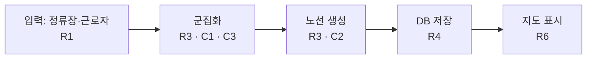

# 설계 질문 · 경계 점검

## 설계 질문

사용자가 "이건 어떻게 만들어야 해?"라고 물으면 선택지 2~3개를 쉬운 말로 낸다.
- 각 선택지에 **"이걸 고르면 어떻게 설명할지" 한 문장**을 붙인다.
- 사용자가 설명하기 어려운 복잡한 선택지는 그 사실을 밝힌다.
- 판정·계산처럼 매번 같은 결과가 나와야 하는 부분은, 고정된 코드로 두는 선택지와 AI 호출로 처리하는 선택지를 구분해 보여 준다. 어느 쪽이 설명하고 검증하기 쉬운지 한 줄 붙인다.
- 고르는 건 사용자다. 고른 결과는 결정 로그에 "설계"로 남긴다.

## 경계 점검 — 구조 그림

그림은 스킬이 그리고, 구조는 사용자가 정한다. 단계 3과 7에 한 번씩, 한 번에 2~3분 안에 끝낸다.

**1. 사용자가 한 줄을 쓴다 (30초).** 최소 틀:

```text
입력(정류장·근로자) → 군집화 → 노선 생성 → DB 저장 → 지도 표시
```

- 이 한 줄이 사용자가 이해한 구조다. 스킬은 단계를 더하거나 빼거나 이름을 바꾸지 않는다.
- 사용자가 한 줄을 쓰지 못하면 그 자체가 신호다. 대신 그려 주지 말고 좁은 질문 두 개만 한다: "데이터는 어디서 들어오나요?", "결과는 누가 어디서 보나요?"

**2. 스킬이 mermaid로 펼친다.** 재료는 그 한 줄과 `REQUIREMENTS.md`뿐이다. 코드를 읽어서 그리지 않는다(느리고 사용자의 이해가 아니다).
- 단계마다 노드 하나, 사용자가 쓴 이름 그대로.
- 노드에 관련 R·C 번호를 붙인다. 붙일 근거가 기록에 없으면 붙이지 않는다.



**3. 세 가지만 짚는다.**

| 구분 | 무엇 | 예 |
|---|---|---|
| 누락 | 필수 R·C 중 어느 노드에도 안 붙은 것 | R7(금요일 좌석) 이 어디에도 없음 |
| 근거 없음 | R·C 번호가 하나도 없는 노드 | "캐시" 노드 — 요구 근거 없음 |
| 흩어짐 | 한 R·C가 여러 노드에 붙은 것. 바뀌면 여러 곳을 고쳐야 한다 | C1이 군집화·노선 생성 둘 다에 붙음 |

흩어짐은 무조건 잘못이 아니다. 같은 이유로 바뀌는 것을 한곳에 모을지는 사용자가 정한다.

**4. 확인 질문 하나 (1분).** 그림의 R·C 중 하나로 "이게 바뀌면 어느 노드를 고쳐야 하나요?"를 묻는다. 사용자가 답한 뒤에만 그림과 맞는지 알려 준다.

**5. 확인받은 그림만 남긴다.** 사용자가 "맞다"고 하면 `HANDOFF.md`의 시스템 경계에 그림을 넣고 `사용자 확인 HH:MM`을 적는다. 사용자가 고친 그림이면 고친 대로 넣는다. 구조를 바꾼 결정은 결정 로그에 "설계"로 남긴다.
